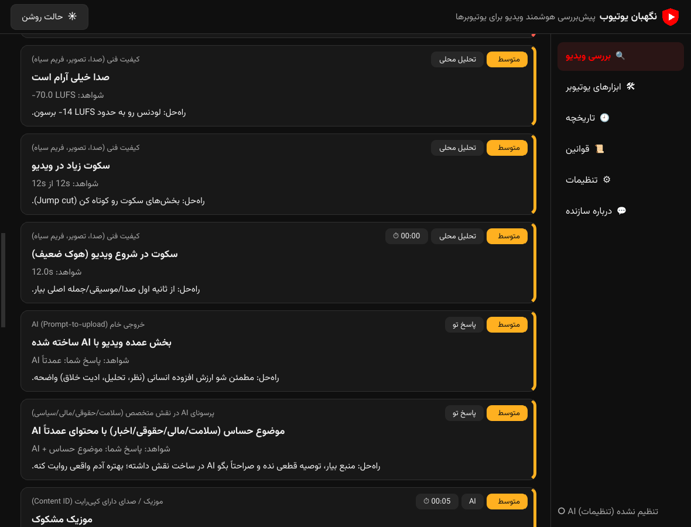
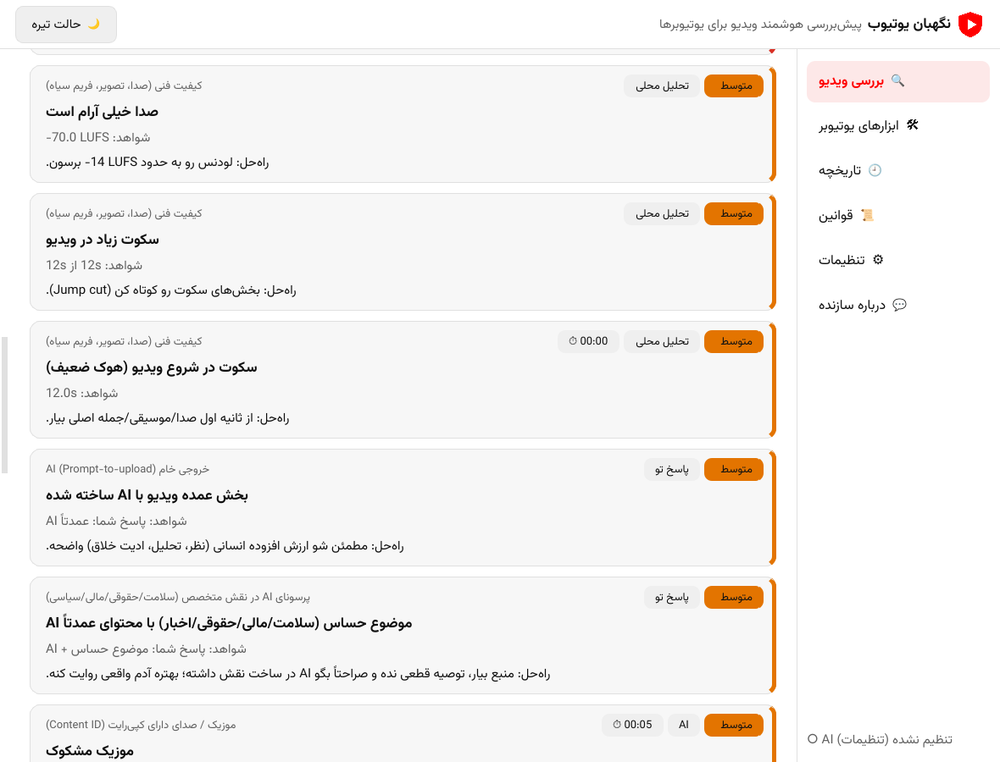

<div dir="rtl" align="right">

<div align="center">


# YT Guard — نگهبان یوتیوب

**بررسی‌کننده‌ی قبل از آپلود و دستیار رشد یوتیوب برای ویندوز**<br>
ویدیو رو قبل از آپلود با قوانین یوتیوب بسنج، علت ویو نگرفتن رو پیدا کن، ایده‌ها و کل کانال رو با AI رایگان بررسی کن.

[English](README.md) · [فارسی](README.fa.md)

 

</div>

---

## قابلیت‌ها

| بخش | کار |
|---|---|
| 🔍 **بررسی ویدیو** | ویدیوی لانگ یا Shorts رو بنداز؛ برنامه چند سوال می‌پرسه، تحلیل محلی و AI انجام می‌ده و امتیاز ریسک، مشکلات با timestamp و راه‌حل می‌ده. |
| 🩺 **چرا ویو نمی‌گیره؟** | با تیتر، تامبنیل، توضیحات، ویدیو (اختیاری) و اعداد Studio، قیف ویو رو مرحله‌به‌مرحله می‌سنجه: نمایش ← کلیک ← ماندگاری ← کشف‌شدن ← تناسب با مخاطب ← قوانین. |
| 💡 **بررسی ایده** | قبل از ساخت: حکم، امتیاز ویو/مانیتایز/امنیت قوانین/اصالت/رقابت، نقاط مثبت و منفی، زاویه‌های بهتر، تیتر و هوک پیشنهادی. |
| 📺 **بررسی کانال** | بهترین و ضعیف‌ترین ویدیوها نسبت به میانه خود کانال، اثر ویژگی‌های تیتر، مقایسه تامبنیل‌ها، چک‌لیست مانیتایز و برنامه بهبود با اولویت. |
| 🛠 **ابزارهای یوتیوبر** | تیتر، توضیحات، تگ، چپتر، ایده تامبنیل، بهترین بخش‌ها برای Shorts، بهبود هوک، پین‌کامنت، متن افشای AI، رونویسی، استخراج بهترین فریم‌ها، تبدیل افقی به ۹:۱۶. |
| 🕘 **تاریخچه و گزارش** | همه بررسی‌ها ذخیره می‌شن؛ خروجی HTML، Markdown یا JSON. |
| 📜 **قوانین** | پایگاه دانش داخلی؛ سطح اطمینان هر منبع (رسمی / گزارش‌شده / تأییدنشده) کنار هر قانون هست. |

### بررسی ویدیو دنبال چی می‌گرده
- **استفاده از AI و افشا**: صدا/تصویر AI، نیاز به تیک *Altered or synthetic content* و متن آماده
- **محتوای غیراصیل / تولید انبوه**: اسلایدشو، شباهت به ویدیوهای قبلی خودت (اثر انگشت فریم‌ها)، خروجی خام AI
- **بازاستفاده و حدس‌های کپی‌رایت**: موزیک، فوتیج، لوگو یا شخصیت مشکوک با timestamp (فقط حدس؛ جایگزین Content ID نیست)
- **مناسب آگهی‌دهنده، Made for Kids، تبلیغ پولی**
- **قوانین Shorts و لانگ**: نسبت تصویر، حداکثر ۳ دقیقه، رزولوشن
- **عوامل ریزش مخاطب**: هوک ضعیف، سکوت، فریم سیاه، لودنس
- **متادیتا**: C2PA، نشانه ابزارهای AI، واترمارک پلتفرم‌های دیگر
- اگه جواب یه سوال روی نتیجه اثر بذاره، **AI از خودت می‌پرسه**

### ماژول‌های جدید چطور صادق می‌مونن
- هرچی قابل محاسبه‌ست (ویو در روز نسبت به میانه خودت، اثر ویژگی‌های تیتر، ریتم آپلود، کنتراست و شلوغی تامبنیل، معیارهای CTR و ماندگاری) محلی حساب می‌شه و به‌عنوان واقعیت به AI داده می‌شه.
- AI به آمار خصوصی یوتیوب و ترند زنده **دسترسی نداره**؛ حرف‌های مربوط به تقاضا و رقابت «تخمین» حساب می‌شن.
- چک‌لیست مانیتایز با سطح‌های منتشرشده‌ی YPP ساخته می‌شه (سطح اولیه: ۵۰۰ سابسکرایبر، ۳ آپلود در ۹۰ روز، ۳٬۰۰۰ ساعت یا ۳ میلیون ویوی Shorts؛ سطح کامل: ۱٬۰۰۰ سابسکرایبر، ۴٬۰۰۰ ساعت یا ۱۰ میلیون ویوی Shorts). ساعت watch time خصوصیه و خودت وارد می‌کنی. یوتیوب از ۱ فوریه ۲۰۲۷ تغییراتی در YPP اعلام کرده؛ جزئیاتش رو از خود یوتیوب چک کن.

---

## شروع کار

### روش الف: نصب‌کننده (پیشنهادی)
1. فایل `YTGuard-Setup-<نسخه>.exe` رو بساز یا دانلود کن و نصب کن.
2. بار اول که برنامه باز شد، **پنجره‌ی پیش‌نیازها** هرچی لازمه رو لیست می‌کنه (اینترنت، دسترسی به Gemini، Visual C++ Runtime، FFmpeg)، یکی‌یکی نصب می‌کنه و کنار هر مورد تیک و درصد کلی نشون می‌ده.
3. توی **تنظیمات** کلید رایگان Gemini رو بذار و «دریافت لیست مدل‌ها» رو بزن.

### روش ب: اجرا از سورس
```bat
git clone https://github.com/mahzoonmmd/YT-Guard.git
cd YT-Guard
run.bat
```
`run.bat` بار اول محیط مجازی می‌سازه و `requirements.txt` رو نصب می‌کنه (Python 3.10+ با تیک Add to PATH).

### ساخت exe و نصب‌کننده (روی ویندوز)
```bat
build_exe.bat          :: PyInstaller -> dist\YTGuard\YTGuard.exe
build_installer.bat    :: ساخت برنامه + Inno Setup 6 -> installer_output\YTGuard-Setup-1.0.0.exe
```

---

## تنظیمات

| تنظیم | از کجا | برای چی |
|---|---|---|
| **کلید Gemini** | <https://aistudio.google.com/apikey> (رایگان) | همه‌ی قابلیت‌های AI؛ فهم مستقیم ویدیو و صدا |
| **کلید YouTube Data API v3** (اختیاری) | [Google Cloud Console](https://console.cloud.google.com/apis/library/youtube.googleapis.com) ← فعال‌سازی API ← Credentials | بررسی کانال (هر تحلیل حدود ۵ از ۱۰٬۰۰۰ واحد سهمیه روزانه). بدون کلید از تب «لیست دستی» استفاده کن. |
| **OpenAI-compatible** (اختیاری) | OpenRouter، Groq، محلی… | موتور جایگزین؛ فقط فریم‌ها می‌ره (بدون صدا) |
| **Proxy** (اختیاری) | مثلاً `http://127.0.0.1:10809` یا `socks5h://127.0.0.1:10808` | جایی که API گوگل در دسترس نیست (مثل ایران) لازمه |

برنامه **بدون AI** هم کار می‌کنه: تحلیل محلی و پرسشنامه‌ی قوانین کاملاً آفلاین اجرا می‌شن.

---

## حریم خصوصی
- تنظیمات، تاریخچه و پیش‌نیازهای دانلودشده توی `%APPDATA%\YTGuard` هستن.
- ویدیو محلی کم‌حجم می‌شه (پیش‌فرض ۴۸۰p) و **فقط** برای سرویس AI که خودت تنظیم کردی ارسال می‌شه. فایل‌های Gemini بعد از حدود ۴۸ ساعت توسط گوگل پاک می‌شن.
- پلن رایگان Gemini ممکنه از ورودی‌ها برای بهبود محصولات گوگل استفاده کنه؛ ویدیوی محرمانه یا منتشرنشده رو با کلید رایگان نفرست.

## محدودیت‌ها
- **Content ID** واقعی قابل شبیه‌سازی نیست و فقط بعد از آپلود (Studio ← Checks) مشخص می‌شه.
- تشخیص AI احتمالاتیه و قوانین یوتیوب مرتب عوض می‌شن؛ هر نتیجه ارزیابی ریسکه، نه تضمین.
- طول ویدیو به پنجره‌ی context مدل (حدود یک ساعت با رزولوشن پیش‌فرض) و سهمیه‌ی پلن رایگان محدوده.
- برنامه با سرورهای ساختگی و رندر آفلاین تست شده. اگه روی ویندوزت مشکلی دیدی Issue بساز.

---

## ساختار پروژه
```
main.py                 نقطه‌ی شروع
ytguard/
  ai_engine.py          Gemini / OpenAI-compatible (آپلود، تلاش مجدد، ترمیم JSON)
  local_checks.py       تحلیل ffmpeg / OpenCV (لودنس، سکوت، فریم سیاه، اثر انگشت، متادیتا)
  questionnaire.py      موتور قوانین آفلاین
  knowledge.py          پایگاه قوانین با سطح اطمینان
  analysis.py           امتیازدهی و ساخت گزارش
  youtube_api.py        کلاینت YouTube Data API v3
  channel_stats.py      آمار کانال و چک‌لیست YPP
  thumb_check.py        بررسی محلی تامبنیل
  prompts*.py           قالب پرامپت‌ها
  workers*.py           thread های پس‌زمینه
  page_*.py, widgets.py صفحه‌ها و کامپوننت‌ها
  prereqs.py            نصب پیش‌نیازها در اولین اجرا (FFmpeg، VC++ Runtime)
  i18n*.py              فارسی / انگلیسی
installer/YTGuard.iss   اسکریپت Inno Setup
tests/                  تست‌های سرور ساختگی و تحلیل محلی
```

---

## حمایت از پروژه
اگه YT Guard جلوی یه آپلود ردشده رو گرفت، به ریپو **Star ⭐** بده و **[@mahzoonmmd](https://github.com/mahzoonmmd)** رو **Follow** کن. Issue و ایده خوشحالمون می‌کنه.

ساخته‌شده توسط **محمدعلی محزون** · فونت: [Vazirmatn](https://github.com/rastikerdar/vazirmatn) (SIL OFL)

</div>
