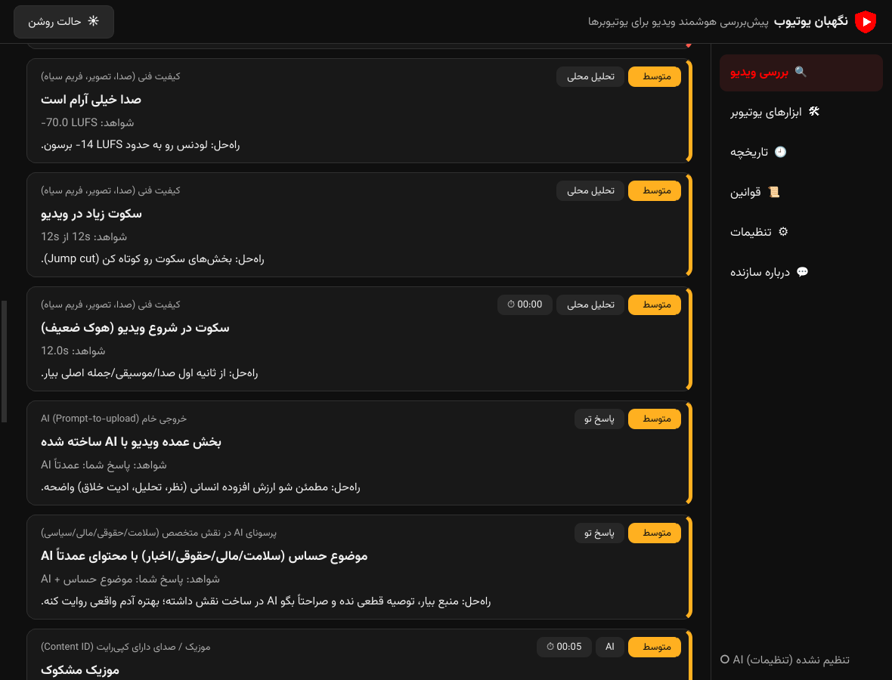
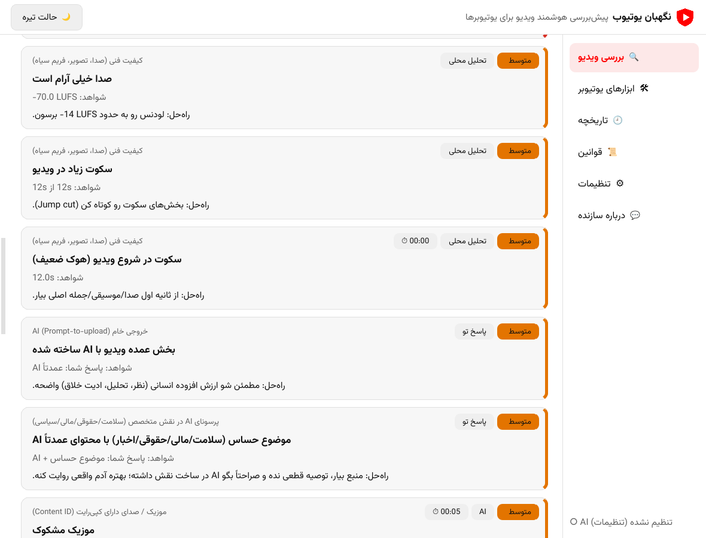

<div align="center">


# YT Guard

**Pre-upload YouTube checker and growth assistant for Windows**<br>
Check videos against YouTube's rules *before* you upload, find out why a video isn't getting views, validate ideas and review whole channels, powered by a free-tier AI.

[English](README.md) · [فارسی](README.fa.md)

   -black) 

 

</div>

---

## Features

| Module | What it does |
|---|---|
| 🔍 **Video check** | Drop a long video or a Short. The app asks a few questions, runs local analysis plus AI review and returns a risk score with timestamped findings and fixes. |
| 🩺 **Why no views?** | Walks a video down the view funnel (impressions → CTR → retention → discovery → audience fit → policy) using title, thumbnail, description, optional video and your Studio numbers. |
| 💡 **Idea check** | Evaluates an idea *before* production: verdict, view / monetization / policy / originality / competition scores, pros and cons, better angles, titles and hooks. |
| 📺 **Channel review** | Compares best and worst videos against the channel's own median, title-feature effects, thumbnails, YPP checklist and gives a prioritized plan. |
| 🛠 **YouTuber tools** | Titles, description, tags, chapters, thumbnail ideas, best Shorts cuts, hook rewrite, pinned comment, AI-disclosure text, transcript, thumbnail frame picker, horizontal → 9:16 converter. |
| 🕘 **History & reports** | Every check is saved; export HTML, Markdown or JSON. |
| 📜 **Rules** | The built-in knowledge base shows every rule with how well its source is verified (official / reported / unverified). |

### What the video check looks for
- **AI usage and disclosure**: likely AI voice or visuals, whether *Altered or synthetic content* must be ticked, ready-to-paste disclosure text
- **Inauthentic / mass-produced content**: static slideshows, near-duplicates of your earlier uploads (frame fingerprints), raw prompt-to-upload output
- **Reused content and copyright suspicions**: suspected music, footage, logos or characters with timestamps (suspicions only; this is **not** Content ID)
- **Advertiser-friendliness, Made for Kids, paid promotion**
- **Shorts and long-form format rules**: aspect ratio, ≤ 3 min, resolution
- **Retention killers**: weak hook, silence, black frames, loudness
- **Metadata**: C2PA / AI-tool markers, other-platform watermark hints
- The AI **asks follow-up questions** when the answer would change the verdict

### How the new analysis modules stay honest
- Numbers that can be computed are computed locally (view-per-day vs. your median, title feature lift, upload cadence, thumbnail contrast and clutter, CTR / retention benchmarks) and handed to the AI as facts.
- The AI has **no access** to YouTube's private analytics or live trends. Demand and competition statements are labelled as estimates.
- The monetization checklist uses the published YouTube Partner Program tiers (early tier: 500 subscribers, 3 uploads in 90 days, 3,000 watch hours or 3M Shorts views; full tier: 1,000 subscribers, 4,000 watch hours or 10M Shorts views). Watch hours are private, so you enter them yourself. YouTube has announced YPP updates from 1 Feb 2027; check YouTube for details.

---

## Getting started

### Option A: installer (recommended)
1. Build or download `YTGuard-Setup-<version>.exe` and install it.
2. On first launch a **prerequisites window** lists everything that is needed (internet check, Gemini reachability, Visual C++ Runtime, FFmpeg), installs each item and shows a checkmark per step with an overall percentage.
3. Open **Settings**, paste your free Gemini key and press *Fetch models*.

### Option B: run from source
```bat
git clone https://github.com/mahzoonmmd/YT-Guard.git
cd YT-Guard
run.bat
```
`run.bat` creates a virtual environment and installs `requirements.txt` on the first run (Python 3.10+, *Add to PATH*).

### Build the exe / installer (on Windows)
```bat
build_exe.bat          :: PyInstaller build -> dist\YTGuard\YTGuard.exe
build_installer.bat    :: build + Inno Setup 6 -> installer_output\YTGuard-Setup-1.0.0.exe
```

---

## Configuration

| Setting | Where to get it | Used for |
|---|---|---|
| **Gemini API key** | <https://aistudio.google.com/apikey> (free) | All AI features; native video and audio understanding |
| **YouTube Data API v3 key** (optional) | [Google Cloud Console](https://console.cloud.google.com/apis/library/youtube.googleapis.com) → enable API → Credentials | Channel review (about 5 of 10,000 daily quota units per analysis). Without it use the *Manual list* tab. |
| **OpenAI-compatible endpoint** (optional) | OpenRouter, Groq, local… | Alternative engine; receives sampled frames only (no audio) |
| **Proxy** (optional) | e.g. `http://127.0.0.1:10809` or `socks5h://127.0.0.1:10808` | Needed where Google APIs are not reachable (for example Iran) |

The app also works **without AI**: local analysis and the rules questionnaire run fully offline.

---

## Privacy
- Settings, history and downloaded prerequisites live in `%APPDATA%\YTGuard`.
- Videos are compressed locally (480p proxy by default) and sent **only** to the AI provider you configure. Gemini files are deleted by Google after about 48 hours.
- The Gemini free tier may use inputs to improve Google products. Do not upload confidential or unreleased material with a free key.

## Limitations
- Real **Content ID** cannot be simulated. You only see it after upload (Studio → Checks).
- AI detection is probabilistic and YouTube policies change often. Treat every result as a risk assessment, not a guarantee.
- Long videos are bounded by the model's context window (roughly an hour at default resolution) and by free-tier quotas.
- Developed and tested against mock servers and offscreen rendering. Please open an issue if something misbehaves on your Windows setup.

---

## Project layout
```
main.py                 entry point
ytguard/
  ai_engine.py          Gemini / OpenAI-compatible providers (upload, retry, JSON repair)
  local_checks.py       ffmpeg / OpenCV analysis (loudness, silence, black frames, fingerprints, metadata)
  questionnaire.py      offline rules engine
  knowledge.py          rule base with source confidence
  analysis.py           scoring and report assembly
  youtube_api.py        YouTube Data API v3 client
  channel_stats.py      channel statistics and YPP checklist
  thumb_check.py        local thumbnail checks
  prompts*.py           prompt templates
  workers*.py           background threads
  page_*.py, widgets.py UI pages and components
  prereqs.py            first-run prerequisites installer (FFmpeg, VC++ Runtime)
  i18n*.py              Persian / English UI
installer/YTGuard.iss   Inno Setup script
tests/                  mock-server and local-analysis tests
```

---

## Support the project
If YT Guard saves you a rejected upload, please **star ⭐ the repository** and **follow [@mahzoonmmd](https://github.com/mahzoonmmd)**. Issues and ideas are welcome.

Made by **Mohammadali Mahzoon** · UI font: [Vazirmatn](https://github.com/rastikerdar/vazirmatn) (SIL OFL)
